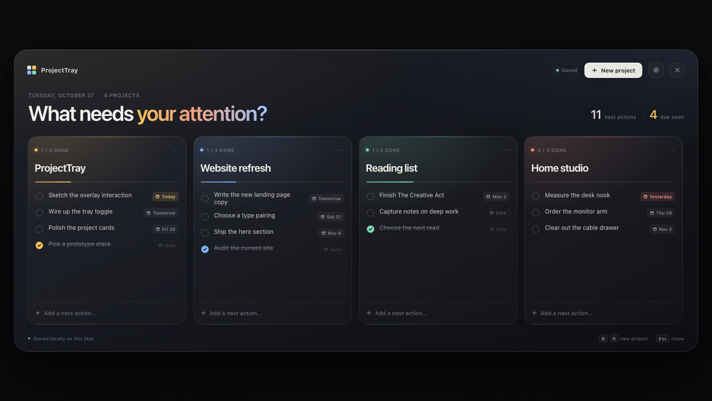
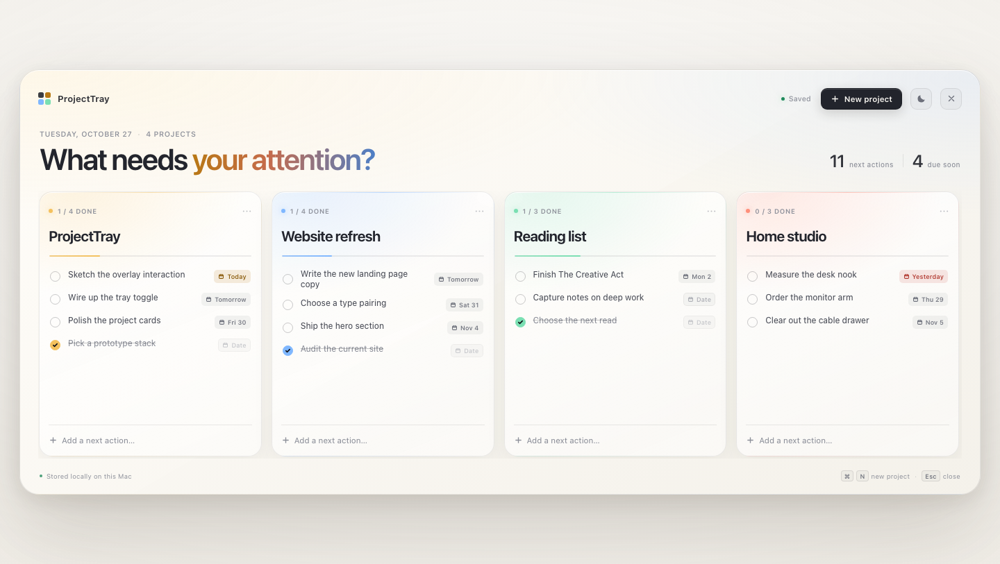

# ProjectTray

A tray-first project dashboard for macOS. ProjectTray lives in the menu bar and
drops a calm, full-screen overlay over whatever you are doing — including a
fullscreen app — so the next actions are always one click away.

| Dark | Light |
| --- | --- |
|  |  |

## What works in this prototype

- Menu bar-only app (no Dock icon), with a custom template tray icon.
- Left-click the tray icon to show or hide the overlay. Right-click for
  **Open ProjectTray** and **Quit**.
- Full-screen overlay that moves to the active macOS Space when it opens and
  uses a `FullScreenAuxiliary` window so it can appear over fullscreen apps,
  including after sleep and wake.
- The overlay sits one level above the Dock, so the Dock stays behind the UI
  instead of covering it. The menu bar stays reachable, so the tray icon can
  still toggle the overlay.
- Native macOS vibrancy provides the blur behind the overlay without the
  in-and-out flicker of a CSS `backdrop-filter`.
- Dark and light themes, switchable with the sun/moon button in the header.
  The choice is saved with the rest of the state.
- Square project cards with editable names, card colors, and inline task lists.
- Long task names wrap onto multiple lines instead of being clipped, while due
  dates stay aligned to the card edge.
- Drag the grip beside a task's date to reorder it, or focus the grip and press
  `↑` / `↓` to move it with the keyboard. Completed tasks stay where you put
  them instead of jumping to the bottom.
- Dates can be deadlines or waiting dates. The picker has a **Deadline** /
  **Waiting** switch with a short hint, and waiting tasks get a clock icon, a
  subdued row, and a tinted date chip so the date itself stays readable.
- Tasks can be completed, renamed, deleted, and given a date with a custom
  calendar picker.
- Add projects and next actions without leaving the overlay.
- Project menus support recoloring, clearing completed tasks, and deleting with
  undo.
- All state is saved locally as JSON by the Rust backend.
- Backup settings live behind the sliders button next to the theme toggle.
  Automatic snapshots are written to a folder you choose, but only while that
  folder is available. This is designed for encrypted volumes such as
  Cryptomator: when the vault is locked, backups pause quietly and resume after
  it is mounted again.
- **Back up now** writes a snapshot immediately. **Restore from file…** replaces
  the current projects with a backup after confirming it contains a project
  list, and keeps a `projecttray-before-restore.json` safety copy in the app data
  folder. The newest 30 automatic snapshots are retained.
- `Esc` or a click on the dimmed backdrop closes the overlay.
- `⌘N` adds a new project.

## Permissions

ProjectTray does **not** need Accessibility, Screen Recording, or Full Disk
Access. The fullscreen behavior comes from native AppKit window ordering and
collection behavior inside the app itself, not from system automation. If you
granted ProjectTray Accessibility access while troubleshooting an earlier
build, you can remove it.

## Run it

Requirements: macOS 12+, Xcode Command Line Tools, Node.js, and Rust.

```bash
npm install
npm run dev
```

The first launch opens the overlay automatically so you can see it. After that,
ProjectTray starts hidden in the menu bar. Left-click the tray icon to open the
overlay, and right-click it for **Open ProjectTray** or **Quit**.

To make a release build:

```bash
npm run build
```

The `.app` and `.dmg` are written under `src-tauri/target/release/bundle/`.

## Testing

```bash
npm test
```

The regression suite drives the UI in headless Chrome through the Chrome
DevTools Protocol. It covers task-row layout (wrapping titles, checkmark
centering, due-date placement), pointer and keyboard reordering, deadline vs.
waiting dates, project and task CRUD, undo, the date picker, theme switching,
backup settings and the browser fallback, and persistence. It starts its own
static server and browser on ephemeral ports and uses an isolated browser
profile, so it does not touch the app's saved state. Chrome is expected at the
standard macOS location; set `CHROME_PATH` to use another Chromium-based
browser. Rust unit tests cover marker-based folder availability, backup
validation, pruning, and the restore safety copy.

## Security automation

- **CodeQL** analyzes JavaScript/TypeScript and Rust on pushes to `main`, on pull
  requests, and on demand from **Actions > CodeQL > Run workflow**.
- **Dependabot** checks npm, Cargo, and GitHub Actions dependencies weekly. To run
  a check manually, open **Insights > Dependency graph > Dependabot** and click
  **Check for updates** next to the manifest you want to check.

## Releasing

The release workflow builds an unsigned `.dmg` on macOS and creates a draft
GitHub release. It runs when a `v*` tag is pushed, or manually from
**Actions > Release > Run workflow**.

Before releasing, set the same version in `package.json`, `package-lock.json`,
`src-tauri/Cargo.toml`, and `src-tauri/tauri.conf.json`. The workflow verifies
that they match and, for tag pushes, that the tag is `v<version>`.

```bash
git tag v0.1.0
git push origin v0.1.0
```

Review the draft release, then publish it once the DMG is ready. The build is
unsigned and not notarized, so macOS may show a Gatekeeper warning on first
launch.

## Where the data lives

```text
~/Library/Application Support/com.projecttray.app/projecttray.json
~/Library/Application Support/com.projecttray.app/settings.json
```

`projecttray.json` is written atomically by the Rust side whenever the UI
changes. Delete it while ProjectTray is closed to start over with the sample
projects. The file also stores the selected `theme` (`"dark"` or `"light"`);
older state files without a theme fall back to the macOS system appearance.

`settings.json` stores the backup toggle and folder path separately, so
restoring a backup never changes where future backups are written. A chosen
backup folder is marked with a hidden `.projecttray-backups` file. Automatic
backups only run while both the folder and that marker are present. Backup files
are named `ProjectTray-backup-YYYY-MM-DD-HHMMSS.json`, and
`projecttray-before-restore.json` is the safety copy written before a restore.

## How it is put together

- **Rust / Tauri 2** — application lifecycle, menu bar item, global window
  behavior, overlay sizing, local persistence, and theme changes.
- **AppKit bridge** — a small amount of Objective-C interop via `objc2-app-kit`
  to apply the `Accessory` activation policy before the window exists, set the
  window just above the Dock, and move the overlay onto the active Space before
  ordering it front. `CanJoinAllSpaces` was not reliably honored for a hidden
  window after macOS changed Spaces, so the overlay uses `MoveToActiveSpace`
  plus `FullScreenAuxiliary` instead.
- **Native vibrancy** — Tauri's `set_effects` applies the
  `UnderWindowBackground` material, so the blur is rendered by macOS and stays
  steady instead of being repainted by the WebView.
- **WebView UI** — dependency-free HTML, CSS, and JavaScript for fast iteration
  on the visual layer. Tauri still owns the native shell and data layer.
- **Pointer-driven task reordering** — the task grip uses pointer events instead
  of HTML5 drag-and-drop, because Tauri's native drag/drop handler intercepts DOM
  drag events on macOS. The window also disables that handler, so the WebView
  owns drag input and reordering behaves the same in WKWebView.

The overlay is a transparent, borderless window that is resized to the display
under the cursor each time it opens. The panel itself is rendered in the
WebView, which makes the interaction model easy to iterate on while keeping the
tray/fullscreen plumbing native.

## Known prototype limitations

- No global keyboard shortcut yet; the tray icon is the entry point.
- Tasks can be reordered within a project, but not dragged between projects.
- No notifications or sync yet.
- The build is unsigned and not notarized.
- Menu bar behavior is macOS-only by design.
